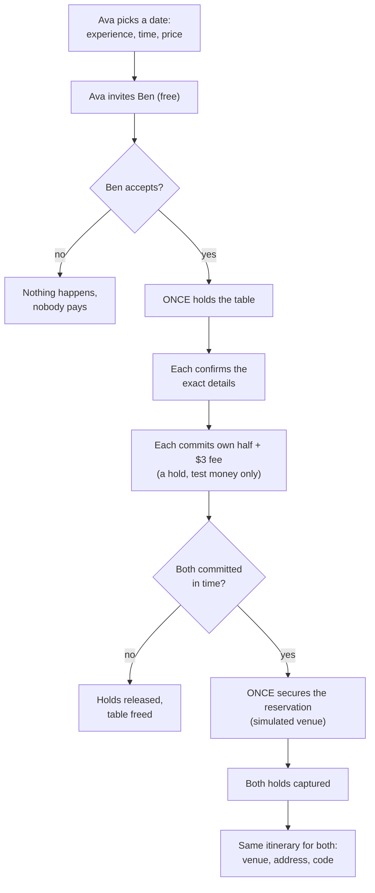
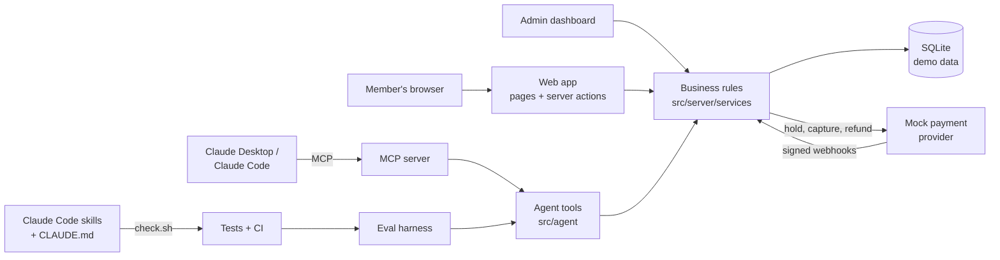

# ONCE: portfolio summary

Repository: https://github.com/imkhoid-byte/irl · Live demo (browsing only, see the note under "Known limits"): https://irldating.netlify.app/

## The idea

Most dating apps match people to talk. ONCE matches them to meet. There is no chat. A match is always a specific plan: an experience, a time, a place and a price. One person invites another to a date slot. If they accept, each person confirms the exact details and pays their own half. When both have paid, ONCE secures the reservation and both people get the same itinerary. If either person doesn't commit in time, nobody is charged.

This is a working MVP: a Next.js web app with an admin dashboard, plus an MCP server, an eval harness and Claude Code skills. Payments go through a mock provider. No real money moves, and every payment record is marked as test data. Venues, venue bookings and identity checks are simulated too.

## Diagrams

### User flow

### System view

## Key engineering decisions

**One set of business rules for every entry point.** The web app, the admin dashboard, the MCP server and the eval harness all call the same functions in `src/server/services`. Each function takes the database explicitly, so it can be tested on its own. This way a rule like "a slot can't be oversold" or "blocked people can't be matched" is written once, and an AI agent can't get around it.

**Payments: hold first, charge only when both have committed.** Each person's commitment is an authorization hold, not a charge. Only when both holds are verified and the venue booking succeeds are both captured. If anything fails along the way, captures are refunded, holds are released and the table is freed. Why: nobody should end up paying for a date the other person never committed to.

**Payment status only comes from signed provider events.** The browser never reports that a payment succeeded. The mock provider sends HMAC-signed events. Each event is processed once and recorded in an append-only ledger. Each payment attempt has an idempotency key, and a database index allows only one live payment per person per date. Why: no faked success and no double charges. The Stripe adapter is written behind the same interface but has not been run against Stripe.

**Race conditions are handled in the database.** Accepting an invitation and holding a table happen in one transaction, using conditional updates ("only if still pending", "only if a table is left") backed by CHECK constraints. Why: two people accepting at once, or two couples taking the last table, must not both succeed. Tests cover both cases.

**Consent to exact terms.** The date's details (experience, time, price split, fee, cancellation deadline) are hashed. Each person confirms that hash before paying, and a time change needs the other person to agree. Why: nobody can be held to details they didn't see.

**AI safety by what the tools can't do.** The agent tools can search, suggest and send a free invitation. No tool can pay, commit, cancel or message anyone, and the invitation tool has no free-text field. Why: the riskiest things an assistant could do here, spending someone's money or passing along contact details, are impossible rather than just discouraged in a prompt.

**An eval that is checked before it is trusted.** The 12 eval cases grade what the agent actually did to the database, not just its reply, and cover both directions: cases where it should act and cases where it shouldn't. Three baseline agents check the grader: known-good answers score 12/12, doing nothing scores 0/12, and always inviting someone scores 1/12. API errors, timeouts and replies served by a different model are kept out of the score.

**Zero-setup demo, with a production schema alongside.** The demo uses SQLite through Node's built-in `node:sqlite`, so a reviewer needs no accounts or services. A Postgres schema with row-level security is in `supabase/migrations/`. I applied it to Postgres 16 and smoke-tested the double-accept guard, the oversell guard and the row-level security.

## Known limits

- **No eval results from Claude yet.** Running the eval against Claude needs an Anthropic API key, and none has been used with this repo. The published numbers are from the baseline agents only.
- **The live demo is not reliable for the full flow.** On Netlify, each running copy of the app has its own temporary database, so sign-ins and invitations can disappear between page loads. The full flow works locally and is covered by the end-to-end tests.
- **Simulated pieces:** payments, venue bookings, identity checks and email are all mocks behind interfaces.

## What I would build next

1. Run the eval against Claude with several repeats per case, publish the results, and read the failing transcripts.
2. Move the demo to a shared persistent database (the Postgres schema exists) so the live demo works end to end.
3. Connect Stripe in test mode through the existing payment interface.
4. Grow the eval set, especially multi-step requests and more safety cases, so differences between models or prompts are measurable.
5. Replace the other mocks with real integrations: venue booking, identity verification and email.

## How it was built

I built this with Claude Code; the commit history shows each step. Tests run in CI on pushes to `main` and on pull requests: lint, typecheck, 52 unit and integration tests, the reference eval and the end-to-end tests.
